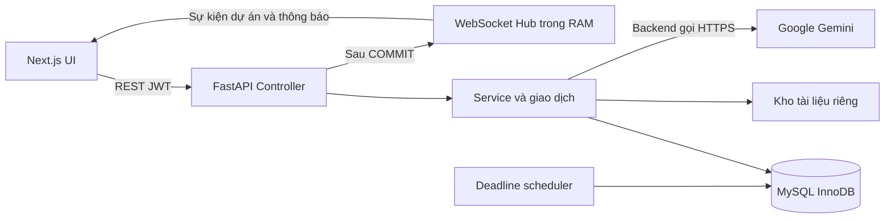

# Smart Task Manager

Đồ án quản lý công việc nhóm của Nhóm 3C: workspace, JWT/RBAC, Kanban realtime, skill matrix, workload và trợ lý Gemini dựa trên tài liệu Project. Giao diện VI/EN. Bản tiến độ lần 2 chốt ngày 21/10/2026 (UTC+7).

[Báo cáo tiến độ lần 2](docs/262701-DACN-01-Nhom3C-BC-02.docx) gồm hiện thực hóa, ảnh chức năng thật, kết quả kiểm thử, phân công và kế hoạch demo.

## Kiến trúc đã triển khai



Một backend worker và một scheduler. Hub/rate limiter nằm trong RAM; chưa có Redis, broker hay outbox. AI tạo bản nháp để người dùng kiểm tra và xác nhận; chưa có vòng lặp Agent tự thực thi công cụ.

| Thành phần | Phiên bản môi trường Docker đã chạy |
|---|---|
| Frontend | Next.js 16.3.7, React 19.3.0, TypeScript 5.9.3 |
| Backend | Python 3.12, FastAPI 0.155.0, SQLAlchemy 2.1.5 |
| CSDL | MySQL 8.4.11/InnoDB, migration 0001–0005 |
| Đối chiếu bổ sung | MariaDB 10.4.32/InnoDB, không thay kết quả MySQL |

Backend khai báo khoảng phiên bản; cần pin bộ dependency trước bản phát hành ổn định. Frontend có package-lock.json.

## Chạy bằng Docker

Cần Docker Engine và Compose đang chạy. Lần đầu tạo cấu hình riêng:

```sh
python scripts/setup_demo_env.py
```

Script chỉ tạo `.env` nếu chưa tồn tại, sinh JWT secret/mật khẩu DB ngẫu nhiên và không in bí mật. Với `.env` có sẵn, đối chiếu các biến MySQL theo `.env.example`. Điền GEMINI_API_KEY riêng nếu muốn dùng AI; để trống vẫn chạy được nghiệp vụ khác.

Khởi động toàn bộ bằng một lệnh:

```sh
docker compose up -d
```

Compose build nếu chưa có image, chờ MySQL khỏe, tự migration/seed qua service initialize rồi chạy API, frontend và scheduler. Sau khi sửa mã chạy `docker compose up -d --build`.

- UI: http://localhost:3000
- Swagger: http://localhost:8000/docs ; ReDoc: http://localhost:8000/redoc
- Xem trạng thái: `docker compose ps -a`; xem lỗi: `docker compose logs initialize backend`.
- Dừng và giữ dữ liệu: `docker compose down`.
- Adminer tùy chọn: `docker compose --profile tools up -d database-admin`, mở http://localhost:8081. Server mysql; user/password/database ở .env.

MySQL và tài liệu ở hai volume riêng. Cờ log-bin-trust-function-creators hỗ trợ tạo trigger snapshot cho demo; production cần xem lại quyền migration và replication.

### Tài khoản demo

Mật khẩu demo công khai mặc định **STM-Demo-Only-2026!**. Chỉ dùng dữ liệu tổng hợp. Đặt DEMO_PASSWORD trước seed nếu cần mật khẩu riêng; seed không đặt lại mật khẩu tài khoản có sẵn.

| Vai trò | Tài khoản |
|---|---|
| OWNER Demo Workspace | owner@demo.example.com |
| OWNER Demo Product Team | owner2@demo.example.com |
| ADMIN cả hai workspace | admin@demo.example.com, admin2@demo.example.com |
| MEMBER cả hai workspace | lan@demo.example.com, long@demo.example.com, mai@demo.example.com, binh@demo.example.com, an@demo.example.com, chi@demo.example.com |

Seed mới tạo 10 user, 2 workspace, 4 project, 20 cột, 40 task, 24 skill (12/workspace), 16 subtask và 40 snapshot. Nhãn AI trong seed chỉ minh họa dữ liệu, không chứng minh chất lượng Gemini. Workspace demo đã tồn tại được bỏ qua, không tự nâng cấp seed cũ.

## Chạy trực tiếp trên Windows

[run.bat](run.bat) cài dependency, tạo DB/migration và chạy API, scheduler, frontend trong một CMD. Mặc định root@127.0.0.1:3306 với mật khẩu rỗng dành cho phát triển. Đặt DATABASE_URL nếu dùng kết nối khác. `run.bat --check` kiểm tra cấu hình. Ctrl+C để dừng, chọn Y nếu CMD hỏi Terminate batch job.

Không chạy đồng thời với Docker trên cùng cổng 3000/8000. [database/schema.sql](database/schema.sql) chỉ áp dụng trên database mới, trống; database có dữ liệu phải nâng bằng Alembic.

## Cấu hình

| Biến | Ý nghĩa |
|---|---|
| MYSQL_ROOT_PASSWORD, MYSQL_USER, MYSQL_PASSWORD, MYSQL_DATABASE | MySQL trong Compose |
| DATABASE_URL | SQLAlchemy URL khi chạy trực tiếp; Compose tự trỏ service mysql |
| JWT_SECRET | Bí mật JWT ngẫu nhiên ít nhất 32 ký tự |
| FRONTEND_ORIGIN | Origin CORS/WebSocket chính xác |
| NEXT_PUBLIC_API_URL | API URL nhìn thấy từ browser, được đưa vào lúc build |
| DOCUMENT_STORAGE_DIR | Kho file riêng; metadata/checksum trong DB |
| GEMINI_API_KEY, GEMINI_MODEL | Chỉ ở backend; chọn model được tài khoản cấp generateContent |
| SMTP_HOST, SMTP_PORT, SMTP_USER, SMTP_PASSWORD, SMTP_FROM | Gửi email reset mật khẩu |
| DEMO_PASSWORD, SEED_DEMO | Mật khẩu seed và bật/tắt seed tự động |

Thiếu Gemini key, AI trả lỗi dịch vụ rõ ràng; thiếu SMTP, quên mật khẩu trả 503. Chưa có email verification.

## Hợp đồng nghiệp vụ

- OWNER/ADMIN quản lý workspace; MEMBER chỉ vào project được cấp quyền. Lời mời PENDING cần đúng người nhận chấp thuận, token có nonce/thời hạn/chống phát lại.
- Access token 15 phút; refresh cookie HttpOnly 14 ngày và rotation. Đổi/reset mật khẩu tăng token_version, thu hồi refresh token.
- PATCH task bắt buộc version dương. Không gửi trường thì giữ nguyên; null chỉ xóa trường cho phép rỗng. Null ở title, estimated_hours, actual_hours hoặc priority trả 422.
- Di chuyển khóa task/cột liên quan theo thứ tự; xung đột version trả 409. Không khóa toàn bộ Project để kéo một thẻ.
- Snapshot giờ ước lượng bất biến bằng trigger; tasks suy ra project_id qua column_id. Không có nghiệp vụ tiền tệ/kho/kế toán.
- PDF/DOCX/TXT/MD gắn Project; phải có tài liệu trước khi hỏi AI hoặc phân rã. File không lưu BLOB trong DB.
- WebSocket `/api/v1/ws/projects/{id}` và `/api/v1/ws/notifications`: token ở message đầu; sự kiện phát sau COMMIT.

Workload tránh cộng trùng task/subtask. MAPE hiện dùng estimate hiện tại của task actual > 0, chưa giới hạn Done và chưa đối chiếu baseline AI cố định; chưa dùng để nghiệm thu AI.

## Kiểm thử có thể tái lập

Trong backend, `python -m pytest -q` dùng SQLite để kiểm tra nhanh. Kiểm tra InnoDB cần DATABASE_URL với quyền tạo DB thử nghiệm:

```sh
python tests/run_verification.py --output-dir ../docs/progress-02/evidence/reproduced
```

Runner tạo DB `_verify_` riêng, migration 0001–0005, chạy 76 test, kiểm tra khóa, snapshot, hai WebSocket và tải. Riêng test seed dùng SQLite tạm. Lỗi Gemini được kiểm tra bằng MockTransport, không đo chất lượng mô hình. DB thử nghiệm giữ để đối chiếu. `--skip-load` phù hợp CI. LOAD_CONCURRENCY điều chỉnh request đồng thời, mặc định 100; tổng tài khoản vẫn 100.

Kết quả ngày 21/10: MySQL 8.4 đạt 76/76 test và các kiểm tra khóa, snapshot, hai WebSocket. Bài tải 100 đồng thời gặp ReadTimeout, **chưa đạt mục tiêu tải 100 người dùng**. MariaDB trước bản sửa token đạt 75/75; số đo của môi trường này không thay kết quả MySQL.

[Bằng chứng tiến độ 2](docs/progress-02/evidence) gồm JUnit, JSON và ảnh thật. [Kịch bản demo](docs/progress-02/DEMO_SCRIPT.md). [Phân công GitHub](docs/progress-02/GITHUB_WORKFLOW.md).

Browser E2E: cài Playwright trong môi trường kiểm thử riêng, rồi chạy `node scripts/capture_progress_evidence.cjs` khi Docker/seed sẵn sàng. Có thể đặt EVIDENCE_CHROME cho browser cài sẵn. Runner đăng nhập hai vai trò, thao tác task thật, thêm task demo mỗi lần chạy; không mock API, không gọi Gemini trả phí.

Frontend: `npm ci`, `npx tsc --noEmit`, `npm run build`. CI chạy MySQL 8 và frontend build trên PR vào develop/main.

GitHub Actions hiện chưa khởi chạy job vì GitHub báo tài khoản bị khóa do vấn đề thanh toán. Cần chủ tài khoản xử lý rồi chạy lại; chưa có CI Pass. [PR #9](https://github.com/xuandang0405/dacn/pull/9) chứa bản nhập mã để review, chưa merge; khi lấy mã ở thời điểm này hãy chọn nhánh `codex/progress-02`. main/develop mới có commit khởi tạo.

## Những phần còn mở

Gemini thật ngày 13/10: 72 lần gọi, 17 phản hồi thành công, 55 lỗi provider/quota; các phản hồi thành công đều bằng tiếng Anh. Chưa có bộ chấm chất lượng hai người. Xem [quy trình AI](docs/testing/AI_EVALUATION.md) và dữ liệu gốc docs/testing. Không dùng seed/mock test thay thí nghiệm này.

Còn mở: tải MySQL 100 đồng thời, MAPE, chất lượng AI/tiếng Việt, SMTP thật, cloud HTTPS, video dự phòng, soak test và RTO/RPO. Đóng băng tính năng sau demo 06/11/2026. Việc dùng FastAPI/MySQL thay đề cương cũ cần giảng viên xác nhận.

## Bảo mật và GitHub

Không commit .env, khóa Gemini, JWT secret, dữ liệu người dùng, storage, node_modules, .venv hay build output. Khóa đã lộ cần chủ tài khoản thu hồi ở nhà cung cấp; xóa khỏi gói nộp không chứng minh đã thu hồi. Tài khoản demo công khai tách khỏi môi trường thật.

Repository: https://github.com/xuandang0405/dacn. main để bàn giao, develop tích hợp, feature/* cho từng phần việc. Mỗi người tự commit bằng tài khoản của mình; commit nhập mã tự động không thay lịch sử đóng góp. Đạt/Khoa được chủ repo thêm sau.
