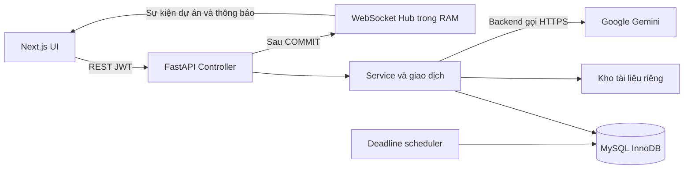

# Smart Task Manager

Đồ án quản lý công việc nhóm của Nhóm 3C: workspace, JWT/RBAC, Kanban realtime, skill matrix, workload và trợ lý Gemini dựa trên tài liệu Project. Giao diện VI/EN. Bản sửa và kiểm thử website ngày 04/11/2026 (UTC+7): [kết quả và cách chạy lại](TEST_REPORT.md).

[Báo cáo tiến độ lần 2](docs/262701-DACN-01-Nhom3C-BC-02.docx) gồm hiện thực hóa, ảnh chức năng thật, kết quả kiểm thử, phân công và kế hoạch demo.

## Nhận việc và push code

Đọc [CONTRIBUTING.md](CONTRIBUTING.md) trước khi nhận việc. Mỗi thành viên làm trên nhánh được phân công, tự push và mở PR kèm kết quả kiểm tra. Trong đợt khởi tạo, chọn base **integration/mvp**; main/develop chờ bản nền được review. [Danh sách phần việc](https://github.com/xuandang0405/dacn/issues?q=is%3Aissue+is%3Aopen).

## Kiến trúc đã triển khai



Một backend worker và một scheduler. Hub/rate limiter nằm trong RAM; chưa có Redis, broker hay outbox. AI tạo bản nháp để người dùng kiểm tra và xác nhận; chưa có vòng lặp Agent tự thực thi công cụ.

| Thành phần | Phiên bản môi trường Docker đã chạy |
|---|---|
| Frontend | Next.js 16.4.5, React 19.3.0, TypeScript 5.9.3 |
| Backend | Python 3.12, FastAPI 0.162.0, SQLAlchemy 2.1.6 |
| CSDL | MySQL 8.4.11/InnoDB, migration 0001–0005 |
| Đối chiếu bổ sung | MariaDB 10.4.32/InnoDB, không thay kết quả MySQL |

Backend dùng requirements.lock để cố định bộ phiên bản đã kiểm tra; frontend dùng package-lock.json. Cài bằng các lệnh trong README để dùng đúng bộ này.

## Chạy bằng Docker

Cần Docker Engine và Compose đang chạy. Lần đầu tạo cấu hình riêng:

```sh
python scripts/setup_demo_env.py
```

Script chỉ tạo `.env` nếu chưa tồn tại, sinh JWT secret/mật khẩu DB ngẫu nhiên và không in bí mật. Với `.env` có sẵn, đối chiếu các biến MySQL theo `.env.example`. Điền GEMINI_API_KEY riêng nếu muốn dùng AI; để trống vẫn chạy được nghiệp vụ khác.

Khởi động toàn bộ bằng một lệnh:

```sh
docker compose up -d
```

Compose build nếu chưa có image, chờ MySQL khỏe, tự migration/seed qua service initialize rồi chạy API, frontend và scheduler. Sau khi sửa mã chạy `docker compose up -d --build`.

- UI: http://localhost:3000
- Swagger: http://localhost:8000/docs ; ReDoc: http://localhost:8000/redoc
- Xem trạng thái: `docker compose ps -a`; xem lỗi: `docker compose logs initialize backend`.
- Dừng và giữ dữ liệu: `docker compose down`.
- Adminer tùy chọn: `docker compose --profile tools up -d database-admin`, mở http://localhost:8081. Server mysql; user/password/database ở .env.

MySQL và tài liệu ở hai volume riêng. Cờ log-bin-trust-function-creators hỗ trợ tạo trigger snapshot cho demo; production cần xem lại quyền migration và replication.

### Tài khoản demo

Mật khẩu demo công khai mặc định **STM-Demo-Only-2026!**. Chỉ dùng dữ liệu tổng hợp. Đặt DEMO_PASSWORD trước seed nếu cần mật khẩu riêng; seed không đặt lại mật khẩu tài khoản có sẵn.

| Vai trò | Tài khoản |
|---|---|
| OWNER Demo Workspace | owner@demo.example.com |
| OWNER Demo Product Team | owner2@demo.example.com |
| ADMIN cả hai workspace | admin@demo.example.com, admin2@demo.example.com |
| MEMBER cả hai workspace | lan@demo.example.com, long@demo.example.com, mai@demo.example.com, binh@demo.example.com, an@demo.example.com, chi@demo.example.com |

Seed mới tạo 10 user, 2 workspace, 4 project, 20 cột, 40 task, 24 skill (12/workspace), 16 subtask và 40 snapshot. Nhãn AI trong seed chỉ minh họa dữ liệu, không chứng minh chất lượng Gemini. Workspace demo đã tồn tại được bỏ qua, không tự nâng cấp seed cũ.

## Chạy trực tiếp trên Windows

[run.bat](run.bat) cài dependency, tạo DB/migration và chạy API, scheduler, frontend trong một CMD. Mặc định root@127.0.0.1:3306 với mật khẩu rỗng dành cho phát triển. Đặt DATABASE_URL nếu dùng kết nối khác. `run.bat --check` kiểm tra cấu hình. Ctrl+C để dừng, chọn Y nếu CMD hỏi Terminate batch job.

Không chạy đồng thời với Docker trên cùng cổng 3000/8000. [database/schema.sql](database/schema.sql) chỉ áp dụng trên database mới, trống; database có dữ liệu phải nâng bằng Alembic.

## Cấu hình

| Biến | Ý nghĩa |
|---|---|
| MYSQL_ROOT_PASSWORD, MYSQL_USER, MYSQL_PASSWORD, MYSQL_DATABASE | MySQL trong Compose |
| DATABASE_URL | SQLAlchemy URL khi chạy trực tiếp; Compose tự trỏ service mysql |
| JWT_SECRET | Bí mật JWT ngẫu nhiên ít nhất 32 ký tự |
| FRONTEND_ORIGIN | Origin CORS/WebSocket chính xác |
| NEXT_PUBLIC_API_URL | API URL nhìn thấy từ browser, được đưa vào lúc build |
| DOCUMENT_STORAGE_DIR | Kho file riêng; metadata/checksum trong DB |
| GEMINI_API_KEY, GEMINI_MODEL | Chỉ ở backend; chọn model được tài khoản cấp generateContent |
| SMTP_HOST, SMTP_PORT, SMTP_USER, SMTP_PASSWORD, SMTP_FROM, SMTP_STARTTLS | Email reset mật khẩu; STARTTLS mặc định bật |
| FRONTEND_PORT, BACKEND_PORT | Cổng host của Docker; đổi cả Origin/API URL tương ứng trước build |
| DB_POOL_SIZE, DB_MAX_OVERFLOW, DB_POOL_TIMEOUT | Pool MySQL, mặc định 20/20/10 giây |
| DEMO_PASSWORD, SEED_DEMO | Mật khẩu seed và bật/tắt seed tự động |

Thiếu Gemini key, AI trả lỗi dịch vụ rõ ràng; thiếu SMTP, quên mật khẩu trả 503. Chưa có email verification.

## Hợp đồng nghiệp vụ

- OWNER/ADMIN quản lý workspace; MEMBER chỉ vào project được cấp quyền. Lời mời PENDING cần đúng người nhận chấp thuận, token có nonce/thời hạn/chống phát lại.
- Access token 15 phút; refresh cookie HttpOnly 14 ngày và rotation. Đổi/reset mật khẩu tăng token_version, thu hồi refresh token.
- PATCH task bắt buộc version dương. Không gửi trường thì giữ nguyên; null chỉ xóa trường cho phép rỗng. Null ở title, estimated_hours, actual_hours hoặc priority trả 422.
- Di chuyển khóa task/cột liên quan theo thứ tự; xung đột version trả 409. Không khóa toàn bộ Project để kéo một thẻ.
- Snapshot giờ ước lượng bất biến bằng trigger; tasks suy ra project_id qua column_id. Không có nghiệp vụ tiền tệ/kho/kế toán.
- PDF/DOCX/TXT/MD gắn Project; phải có tài liệu trước khi hỏi AI hoặc phân rã. File không lưu BLOB trong DB.
- WebSocket `/api/v1/ws/projects/{id}` và `/api/v1/ws/notifications`: token ở message đầu; sự kiện phát sau COMMIT.

Workload tránh cộng trùng task/subtask. MAPE chỉ lấy task Done có actual > 0, so với snapshot ước lượng **lớn hơn 0 đầu tiên**. Số 0 lúc tạo thẻ chưa được xem là ước lượng. Sửa estimate về sau không đổi mốc này. Nhãn AI là nguồn của ước lượng đã được người dùng duyệt; MAPE này không thay cho đánh giá phản hồi Gemini gốc.

## Kiểm thử có thể tái lập

Trong backend, `python -m pytest -q` dùng SQLite để kiểm tra nhanh. Kiểm tra InnoDB cần DATABASE_URL với quyền tạo DB thử nghiệm:

```sh
python tests/run_verification.py --output-dir ../docs/progress-02/evidence/reproduced
```

Runner tạo DB `_verify_` riêng, migration 0001–0005, chạy 96 test, kiểm tra khóa, snapshot, hai WebSocket và tải. Riêng test seed dùng SQLite tạm. Lỗi Gemini được kiểm tra bằng MockTransport, không đo chất lượng mô hình. DB thử nghiệm giữ để đối chiếu. `--skip-load` phù hợp CI. LOAD_CONCURRENCY mặc định 100; LOAD_WEBSOCKETS mặc định 2; tổng tài khoản vẫn 100.

Ngày 04/11, MySQL 8.4 và kiểm tra nhanh SQLite đều đạt 96/96 test. Bài tải API một worker, 100 tài khoản đồng thời, 500 lượt đọc + 500 lượt sửa: không lỗi HTTP; p95 đọc 1150 ms, sửa 1383 ms. Hai client WebSocket nhận đủ 500 cập nhật/client. Đây là phép thử ngắn, chưa phải soak test hay cam kết SLA. [Bằng chứng mới](docs/final-verification).

[Bằng chứng tiến độ 2](docs/progress-02/evidence) gồm JUnit, JSON và ảnh thật. [Kịch bản demo](docs/progress-02/DEMO_SCRIPT.md). [Phân công GitHub](docs/progress-02/GITHUB_WORKFLOW.md).

Browser E2E: chạy `docker compose -f docker-compose.yml -f docker/compose.mail.yml up -d --build --wait` để có hộp thư SMTP thử nghiệm tại http://localhost:8025. Trong frontend: `npm ci`, `npx playwright install chromium`, `npm run test:e2e`. Bài kiểm tra tạo hai tài khoản/dữ liệu tổng hợp, dùng API thật, thử PDF/DOCX/TXT, xung đột phiên bản, realtime, VI/EN, mobile và reset mật khẩu qua Mailpit. Mặc định không gọi Gemini; E2E_LIVE_AI=1 chỉ dùng khi đã có khóa và quota. Mailpit không gửi email ra Internet.

Frontend: `npm ci`, `npm run lint`, `npm test`, `npx tsc --noEmit`, `npm run build`, `npm audit`. CI kiểm tra MySQL 8, frontend và website/Docker trên PR. Mỗi phân hệ có smoke check tại docker/smoke_*.py; xem TEST_REPORT.md.

Xem tab Actions của PR để kiểm tra đúng commit mới nhất; chỉ merge sau khi các job đạt và có review thực tế. Nhánh integration/mvp nhận tích hợp hiện tại; main/develop chờ review trước khi nhập bản nền.

## Những phần còn mở

Gemini thật ngày 13/10: 72 lần gọi, 17 phản hồi thành công, 55 lỗi provider/quota; các phản hồi thành công đều bằng tiếng Anh. Chưa có bộ chấm chất lượng hai người. Xem [quy trình AI](docs/testing/AI_EVALUATION.md) và dữ liệu gốc docs/testing. Không dùng seed/mock test thay thí nghiệm này.

Còn cần xác nhận bên ngoài: khóa/quota Gemini hợp lệ để đo AI thật, SMTP Internet, triển khai cloud HTTPS, video dự phòng, soak test và RTO/RPO. Luồng mật khẩu đã thử qua SMTP cục bộ. Việc dùng FastAPI/MySQL thay đề cương cũ cần giảng viên xác nhận. Phạm vi tính năng giữ nguyên theo bản đồ án đã chốt.

## Bảo mật và GitHub

Không commit .env, khóa Gemini, JWT secret, dữ liệu người dùng, storage, node_modules, .venv hay build output. Khóa đã lộ cần chủ tài khoản thu hồi ở nhà cung cấp; xóa khỏi gói nộp không chứng minh đã thu hồi. Tài khoản demo công khai tách khỏi môi trường thật.

Repository: https://github.com/xuandang0405/dacn. Quy trình nhánh, push và review nằm trong [CONTRIBUTING.md](CONTRIBUTING.md). Đạt/Khoa được chủ repository thêm sau.
